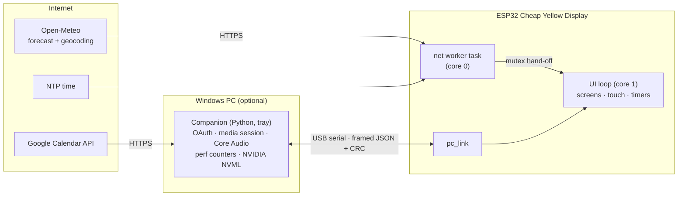

# Desktop Companion

**A polished, touch-driven smart display built on a $15 ESP32 "Cheap Yellow Display".**
It shows a clock, live weather and a shared family calendar at a glance, runs timers and focus
sessions, and, when plugged into a Windows PC, controls music and shows PC load. A small
Python companion feeds it, designed to be safe to run while gaming.

<!-- Photos: add assets/photos/home.jpg, calendar.jpg, music.jpg, pc.jpg and uncomment.
| Home | Calendar | Music | PC |
|---|---|---|---|
|  |  |  |  |
-->


## Features

| | |
|---|---|
| **Home** | Large clock, date, current weather, "Up next" events with live countdowns, running-timer line |
| **Weather** | Hourly (12 h) and 7-day forecast from Open-Meteo, vector weather icons |
| **Calendar** | Week strip with per-calendar colour dots + day agenda; two people's calendars merged |
| **Timers** | Countdown, stopwatch with laps, focus (pomodoro) cycles; alerts on screen, the board's RGB LED and a PC chime |
| **Music** | Now playing, play/pause/skip and master volume for whatever plays on the PC |
| **PC** | CPU, GPU (+ temperature), memory and network tiles, every 2 s |
| **Setup** | Wi-Fi + location entered from a phone via a QR code; nothing hard-coded |
| **Comfort** | Night auto-dimming from the light sensor, soft screen transitions, wireless firmware updates |

## How it works



- **Device-first:** time, weather, timers and the UI work with no PC at all; the PC adds the calendar,
  music and stats. The last calendar is kept in flash, so it survives reboots.
- **Never blocks the UI:** HTTPS runs on a separate core; results are handed over under a mutex.
  Screens redraw only what changed, through off-screen sprites (no flicker).
- **No secrets in code:** Wi-Fi and location are entered on the device; Google OAuth lives only on
  the PC; the OTA password sits in a gitignored file.

## Engineering highlights

- **Custom typography:** a tool converts Inter into TFT_eSPI anti-aliased fonts at exactly the sizes the
  layout needs, with fixed-width digits so running timers don't jiggle.
- **Resistive touch done properly:** a least-squares affine calibration (5–7 px error), pressure
  hysteresis and padded hit targets, all tuned from logged stylus data.
- **Robust networking:** phone setup portal with credential rollback, verified TLS against bundled
  ISRG roots, IANA→POSIX time zones, exponential backoff.
- **A versioned USB protocol** (`@json|CRC16`) sharing the line with human-readable logs, and a
  reset-free serial open (this board resets on DTR/RTS).
- **Gaming-safe companion:** no kernel drivers, no simulated input, no hooks. Below-normal priority,
  single instance, starts with Windows.
- **Memory-aware rendering:** measured the largest free heap block (110 KB) and split larger cards
  into per-row sprites.

The bugs found on real hardware, and how they were fixed, are in
[docs/case-study.md](docs/case-study.md) and the "Lessons" table in
[docs/architecture.md](docs/architecture.md).

## Hardware

ESP32-2432S028R ("Cheap Yellow Display"): ESP32-WROOM-32, 2.8" 320×240 ILI9341 TFT, XPT2046
resistive touch, RGB LED, light sensor, micro-SD, CH340 USB-serial. Pin map and troubleshooting:
[docs/hardware.md](docs/hardware.md).

## Repository

```
firmware/            PlatformIO project (Arduino-ESP32 2.0.17, TFT_eSPI)
  include/, src/     modules - see docs/architecture.md
  scripts/           build helpers (build stamp, USB BOOT wait)
windows-companion/   Python tray app: calendar, music, PC stats, alerts (see its README)
tools/make_fonts.py  TTF -> anti-aliased device fonts (+ preview image)
assets/fonts/        Inter (SIL OFL 1.1)
docs/                architecture, protocol, hardware, backlog, case study
```

## Status

| Milestone | State |
|---|---|
| 1. Display bring-up (landscape diagnostic screen) | **Verified on hardware** 2026-11-07 (single-USB board, `env:cyd`) |
| 2. Touch input + calibration (NVS-stored, 5-point verified) | **Verified on hardware** 2026-11-07 (5–7 px centre error) |
| 3a. Screen framework, fonts, Home screen | **Verified on hardware** 2026-11-07 |
| 3b. Calendar (week strip + agenda), Apps launcher, Settings, back navigation | **Verified on hardware** 2026-11-07 |
| 3c. Weather screen: Hourly (12 h) + 7 Day tabs | **Verified on hardware** 2026-11-07 |
| 4. WiFi + location setup from a phone, NTP time, live Open-Meteo weather | **Verified on hardware** 2026-11-07 |
| 5. Google Calendar via the Windows companion (USB protocol v1) | **Verified on hardware** 2026-11-07 |
| 6. Companion tray app: background, starts with Windows, below-normal priority | **Verified** 2026-11-07 |
| 7. Timer + stopwatch, focus (pomodoro); alerts on screen, RGB LED and PC chime | **Verified on hardware** 2026-11-07 |
| 8. Music controls + PC stats (anti-cheat safe), Return-to-Home setting | **Verified on hardware** 2026-11-07 |
| 9. Wireless updates (OTA), night auto-dim, screen fade transitions, versioning | **Verified on hardware** 2026-11-07 |
| 10. Portfolio write-up | Done; photos to add |

Ideas parked for later: [docs/backlog.md](docs/backlog.md).

## Build and flash

From `firmware/` (or use the PlatformIO toolbar in VS Code). First copy
`firmware/secrets.example.ini` to `firmware/secrets.ini` and set a long random OTA password.

```
pio run -e cyd_ota -t upload   # normal: wireless update over the home network
pio run -e cyd -t upload       # first install / recovery: USB (COM3)
```

**Wireless (OTA):** password-protected, local network only; the device shows a progress
screen. The first time, allow Python through Windows Firewall when asked.

**USB:** this board's auto-reset can't enter download mode. Start the upload, then
**hold BOOT** while it shows `Connecting....`. Stop the companion tray app first (it owns COM3).

**First-time setup:** the device opens a setup Wi-Fi network and shows a QR code. Join it with a phone,
pick your Wi-Fi and enter a city or ZIP code. Change it later under Settings > Wi-Fi & location.

**Recalibrate touch:** Settings > Recalibrate touch, or hold a finger on the screen while the board powers up.

If colours look inverted, use `-e cyd2usb` instead (see docs/hardware.md).

The Windows companion has its own setup (including the one-time Google OAuth client):
[windows-companion/README.md](windows-companion/README.md).

## License

MIT, see [LICENSE](LICENSE). The bundled Inter font is under the SIL Open Font License 1.1
([assets/fonts/inter/OFL.txt](assets/fonts/inter/OFL.txt)).
