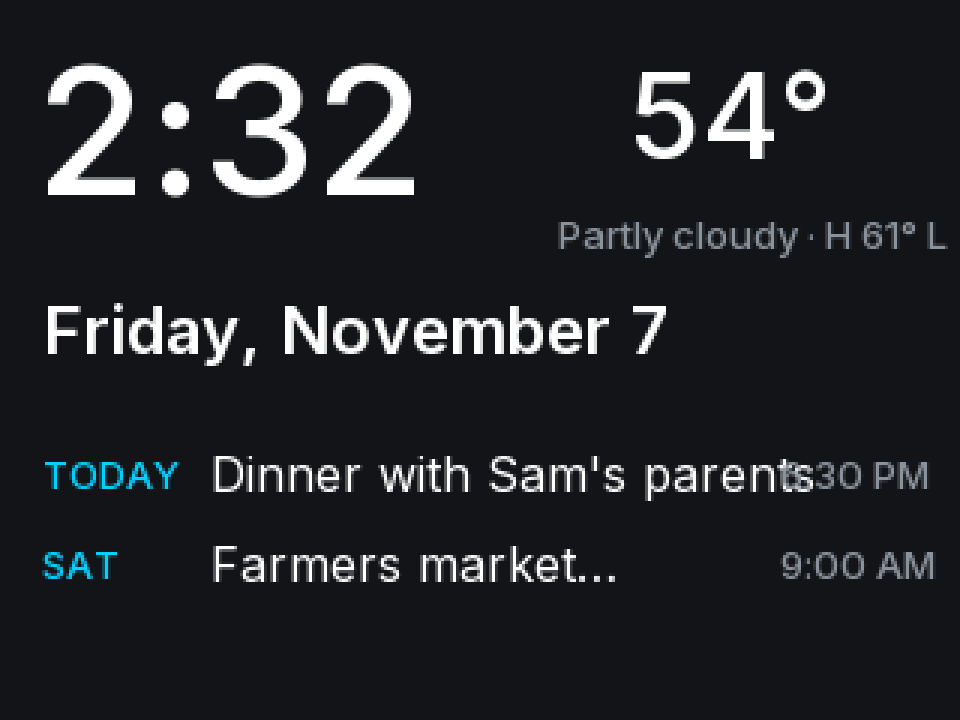

# Desktop Companion

A standalone smart display built on the ESP32-2432S028R "Cheap Yellow Display"
(320×240 resistive touchscreen). It's an always-on clock, weather and shared-calendar glance
screen for the desk or kitchen, with optional PC stats and media controls when it's
plugged into a Windows PC.



## Layout

```
DesktopCompanion/
  firmware/            PlatformIO project (Arduino, TFT_eSPI)
    platformio.ini     board + TFT_eSPI display configuration
    include/, src/     modules (see docs/architecture.md)
    scripts/           build helpers
  tools/make_fonts.py  TTF -> anti-aliased TFT_eSPI fonts
  assets/fonts/        Inter (SIL OFL) + generated preview
  docs/
    architecture.md    system + firmware design
    hardware.md        pin map, display/touch config, troubleshooting
    backlog.md         ideas parked for later
```

A Windows companion app (Python) for PC-only features is optional and not started.

## Status

| Milestone | State |
|---|---|
| 1. Display bring-up (landscape diagnostic screen) | **Verified on hardware** 2026-11-07 (single-USB board, `env:cyd`) |
| 2. Touch input + calibration (NVS-stored, 5-point verified) | **Verified on hardware** 2026-11-07 (5–7 px centre error) |
| 3a. Screen framework, fonts, Home screen (demo data) | **Verified on hardware** 2026-11-07 |
| 3b. Calendar (week strip + agenda), Apps launcher, Settings, back navigation | **Verified on hardware** 2026-11-07 |
| 3c. Weather screen: Hourly (12 h) + 7 Day tabs | **Verified on hardware** 2026-11-07 |
| 4. WiFi + location setup from a phone, NTP time, live Open-Meteo weather | **Verified on hardware** 2026-11-07 |
| 4b. Google Calendar (access method to decide) | Next |
| 5. Timer + stopwatch, focus timer | Planned |

## Build and flash

From `firmware/` (or use the PlatformIO toolbar in VS Code):

```
pio run -e cyd                 # build
pio run -e cyd -t upload       # flash via COM3
pio device monitor             # serial log @ 115200
```

**Uploading:** this board's auto-reset can't enter download mode. Start the upload, then
**hold BOOT** while it shows `Connecting....`. The upload waits indefinitely for this.

**First-time setup:** the device opens a setup Wi-Fi network and shows a QR code. Join it with a phone,
pick your Wi-Fi and enter a city or ZIP code. Change it later under Settings > Wi-Fi & location.

**Recalibrate touch:** Settings > Recalibrate touch, or hold a finger on the screen while the board powers up.

If colours look inverted, use `-e cyd2usb` instead (see docs/hardware.md).
